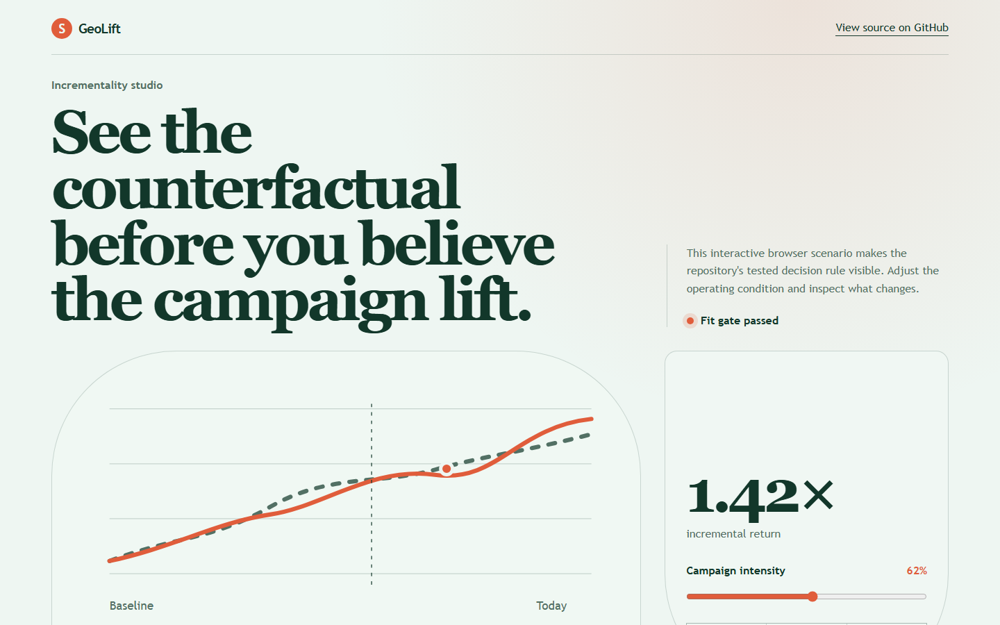
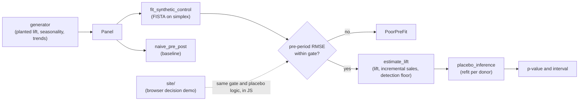

# geolift

Geo incrementality testing by synthetic control, with a pre-period fit gate and placebo inference, so the lift number survives scrutiny.

[](https://github.com/SlateGitOrg/geolift/actions/workflows/ci.yml)
[Live demo](https://slategitorg.github.io/geolift/)



## Why

Platform dashboards report returns on regional media that mostly count people who would have bought anyway. A brand can see a 6.2x reported return and then watch sales stay flat when spend is paused in two regions. Comparing treated and untreated regions after the fact does not fix this, because it credits an ordinary regional demand difference to the campaign. geolift builds the counterfactual from donor regions that track the treated region before the campaign, refuses to report a lift when that fit is poor, and gets its p-value from placebo runs instead of a t-test.

## Features

- Synthetic-control fit with non-negative donor weights that sum to one, solved by accelerated projected gradient descent (FISTA) over a precomputed Gram matrix.
- A pre-period fit gate enforced in code: a fit whose RMSE exceeds 5.5% of the treated region's scale raises `PoorPreFit` instead of returning a number. A pre-period shorter than 12 weeks is refused too.
- A minimum detectable lift reported next to every estimate, so a lift smaller than the fit error is flagged as not measurable.
- Placebo inference: the same estimator is rerun with each donor treated as if it had received the campaign, giving a p-value and an interval derived from that distribution.
- A synthetic panel generator with a known planted lift, shared seasonality, region-specific trends and noise, so estimator bias and coverage can be measured.
- A before/after baseline (`naive_pre_post`) for comparison against the synthetic-control estimate.
- A browser demo (static site, deployed to GitHub Pages) that runs the fit-gate and placebo decision on inputs you edit.

## Architecture



The Python core (`src/`) uses only the standard library. `generator.py` produces a `Panel` of regional weekly sales. `scm.py` fits donor weights on the pre-period, applies the gate, estimates the lift, and runs placebo inference. `demo.py` prints the whole story in one run. The `site/` app is a separate, simplified JavaScript implementation of the gate-then-placebo decision on summary inputs (it does not refit a model in the browser).

## Quick start

Requires Python 3.11+. There is nothing to install; the core uses only the standard library.

```bash
git clone https://github.com/SlateGitOrg/geolift.git
cd geolift
python3 -m unittest discover -s tests -v   # run the suite (about 15 s)
python3 -m src.demo                        # run the end-to-end demo
```

To run the site checks, you also need Node 20+:

```bash
python3 scripts/validate_site.py
node --test site/core.test.mjs
```

## Usage

```python
from src.generator import generate
from src.scm import estimate_lift, placebo_inference, PoorPreFit

panel = generate(regions=40, weeks=104, pre_period=78, true_lift=0.04, seed=1)
treated = panel.treated[0]

est = estimate_lift(panel, treated)          # raises PoorPreFit on a bad fit
print(f"{est.lift:+.2%}", f"floor {est.minimum_detectable_lift:.2%}")

result = placebo_inference(panel, treated, max_placebos=15)
print(result.p_value, result.ci_low, result.ci_high)
```

`python3 -m src.demo` prints, abridged:

```
  40 regions, 104 weeks, 78 pre-period. Treated: R00.
  TRUE lift applied by the generator: 4.0%

  WHAT A BEFORE/AFTER COMPARISON REPORTS
    -22.3%

  THE SYNTHETIC CONTROL
    pre-period RMSE: 2.62% of scale (gate: 5.5%)
    estimated lift: +4.28%   (truth 4.0%)
    detection floor: 3.93%   above it: True

  PLACEBO INFERENCE
    15 donors run as pretend-treated; 0 scored as high
    p = 0.062

  THE TWO REFUSALS
    poor pre-fit  -> pre-period RMSE is 29.9% of scale (limit 5.5%); the synthetic control does not track R00 before treatment, so it cannot be trusted after
    below the floor -> a 2% lift measured at +2.29% with a floor of 3.93%
```

## How it works

- **Counterfactual.** Weights over donor regions are fit to the treated region's pre-period series, constrained to the probability simplex. The constraint stops the fit from extrapolating with large offsetting weights that match the past and mean nothing afterwards. Weights are sparse, so a person can sanity-check which regions drive the counterfactual.
- **Speed.** The gradient comes from a Gram matrix computed once, and FISTA momentum cuts the iterations needed. This matters because placebo inference refits the model once per donor; a slow fit makes the honest inference step tempting to skip.
- **Fit gate.** The threshold must sit above the irreducible weekly noise or nothing could pass. The generator's noise is about 3%, so a good fit lands near 3-4% and the gate is 5.5%. Calibrate it on your own data.
- **Detection floor.** `minimum_detectable_lift` is 1.5 times the normalised pre-period RMSE. A lift below it is mostly fit error; the demo shows a 2% lift measured at +2.29% against a 3.93% floor.
- **Inference.** The treated post/pre error ratio is compared with the same ratio for each placebo donor. A t-test over weekly observations would assume independence across time that trending, seasonal series do not have. The interval is centred on the estimate with a width taken from the 5th to 95th percentile spread of placebo lifts.

More detail is in [docs/ARCHITECTURE.md](docs/ARCHITECTURE.md).

## Testing

```bash
python3 -m unittest discover -s tests -v
```

20 tests in `tests/test_simulation.py` cover:

- **Recovery:** the planted lift is recovered, the estimate beats before/after, and larger lifts estimate larger.
- **Null behaviour:** across 30 simulated no-campaign experiments, significant results stay under 25% and the mean estimate stays within 2 points of zero. Power is checked too: a 10% lift is detected in more than half of 20 experiments.
- **Fit gate:** most healthy panels pass, some regions legitimately fail, poor fits and short pre-periods are refused with an explanatory message.
- **Weights and placebo:** weights are non-negative and sum to one, the treated region is never its own donor, and the p-value and interval come from the placebo distribution.

CI runs the suite and the site checks on every push, then deploys the site to GitHub Pages from `main`.

## Project layout

```
src/
  generator.py   synthetic panel with a planted lift, before/after baseline
  scm.py         synthetic control, fit gate, lift estimate, placebo inference
  demo.py        end-to-end demo
tests/           simulation, null-behaviour, gate and weight tests
site/            browser decision demo (HTML, CSS, ES modules, node tests)
scripts/         site validation
docs/            architecture notes and screenshots
```

## Limitations

- Single treated unit per estimate; the generator treats two regions but each is estimated separately.
- The generator is synthetic. Real regional series will have different covariance and need the gate threshold recalibrated.
- Placebo inference uses at most 30 donors by default, so the smallest attainable p-value is limited by the donor count.
- The browser demo works on summary inputs and does not fit a model.
- Not a marketing-mix model: geo experiments measure incrementality, MMMs allocate budget, and the two are complementary.

## License

MIT — see [LICENSE](LICENSE).
