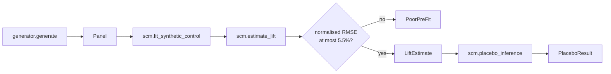

# Architecture

## Context

Attribution-based measurement credits media with sales that would have happened anyway. A geo experiment instead withholds or adds spend in some regions and measures the difference. With only a few treated regions and strongly trending, seasonal series, the hard parts are building a credible counterfactual and judging whether an observed gap is unusual. geolift addresses both, and refuses to answer when the data cannot support one.

## Components

- `generator.py` builds a `Panel` (region to weekly sales, pre-period length, treated regions, true lift). The panel has a shared national factor with seasonality, per-region trend and loading, and idiosyncratic noise.
- `scm.py` fits donor weights, enforces the gate, computes the lift, and runs placebo inference.
- `demo.py` runs the full flow and prints the pre-period fit as an inline chart.
- `site/` is a browser demo of the gate-then-placebo decision on summary inputs.

## Key decisions

**Simplex-constrained weights.** Weights are non-negative and sum to one. Unconstrained regression can fit the pre-period almost perfectly with large positive and negative weights and then produce a counterfactual outside anything the data supports. The cost is a slightly worse in-sample fit.

**FISTA over a Gram matrix.** The gradient is computed from a Gram matrix built once, and momentum reduces the iteration count. Placebo inference refits once per donor, so fit speed decides whether honest inference is affordable.

**Fit gate in code.** `estimate_lift` raises `PoorPreFit` when the pre-period RMSE exceeds 5.5% of scale or the pre-period is under 12 weeks. The threshold must sit above the irreducible noise, or the gate rejects everything. It is a calibrated constant, not a universal one.

**Detection floor.** Every estimate carries `minimum_detectable_lift`, 1.5 times the normalised pre-period RMSE. It tells the reader whether the experiment could have resolved the effect at all. The trade-off is that the multiple is a heuristic.

**Placebo p-value.** The treated post/pre error ratio is ranked against the same ratio from each donor treated as if it had the campaign. This avoids assuming independence across weeks. With few donors the resolution of the p-value is coarse.

## Failure modes

- Poor pre-period fit: refused with a message stating the RMSE and the limit.
- Pre-period too short: refused.
- Lift below the detection floor: returned, flagged by `above_detection_floor` being false.
- A placebo donor whose own fit fails is skipped; fewer than five remaining donors skips that placebo.

## Out of scope

- Marketing-mix modelling and budget allocation.
- Multiple treated regions estimated jointly.
- Real-data ingestion; the repo works on synthetic panels.
